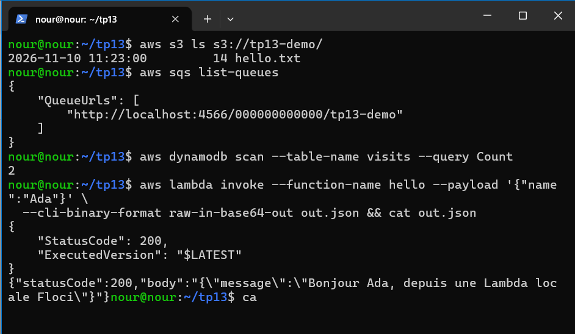
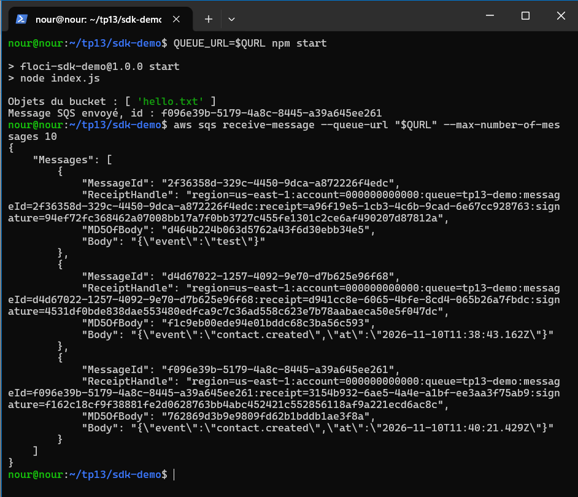
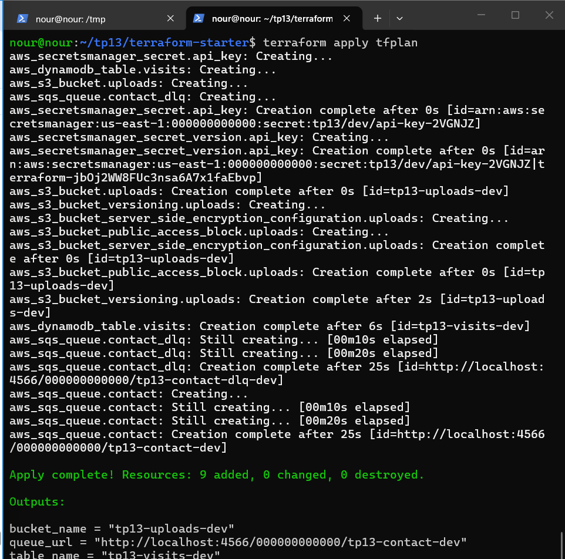
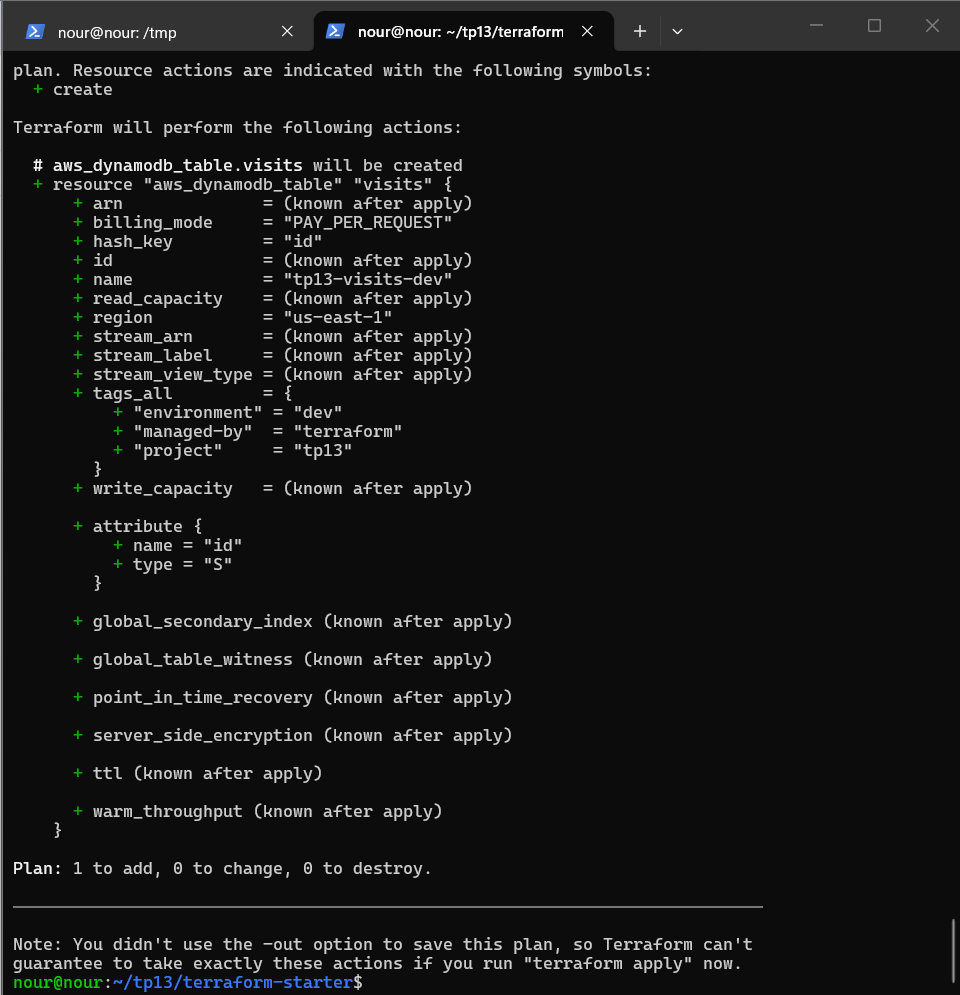
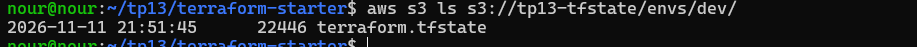
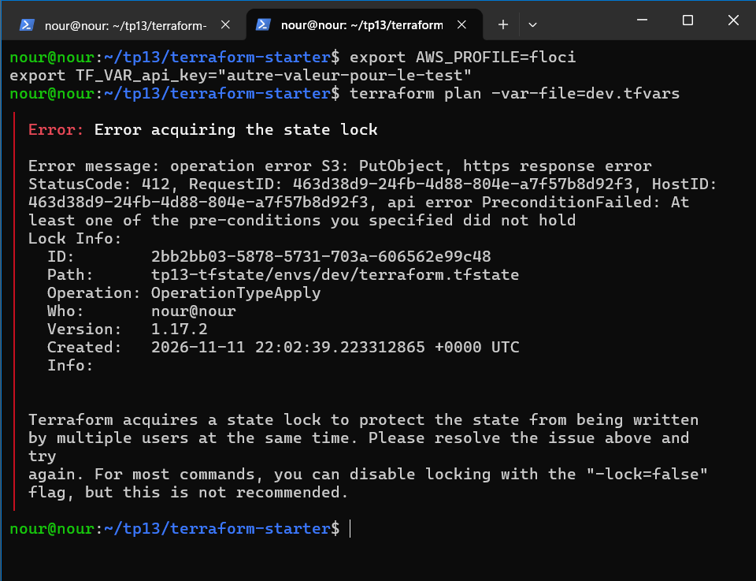
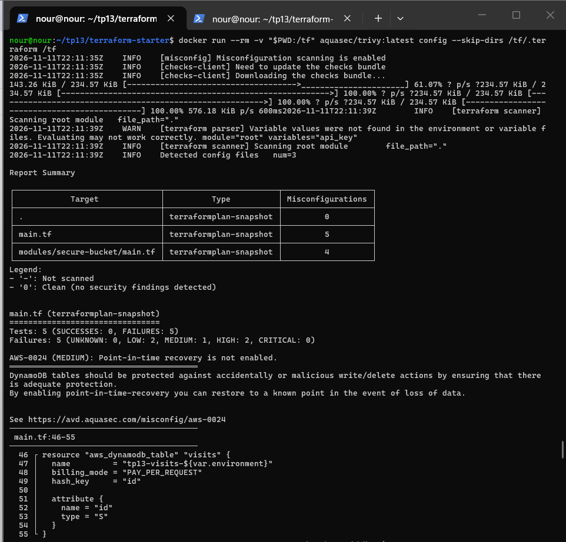
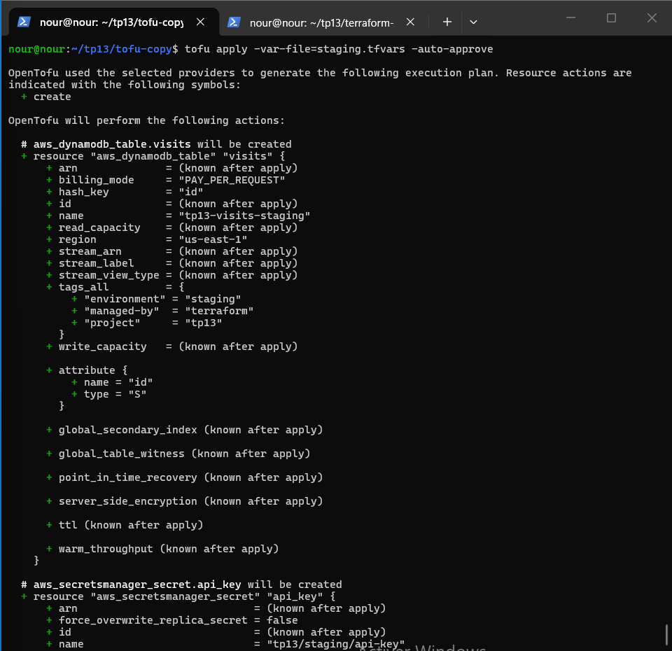

# TP13 : Cloud AWS local avec Floci et Terraform avancé

**Étudiante :** Nour Kidoudi — Master DevOps & Cloud Computing, ISET Tozeur

## 1. Contenu du dépôt
- `lambda/` : fonction Lambda de test
- `sdk-demo/` : programme SDK JavaScript v3 (S3 + SQS)
- `terraform-starter/` : projet Terraform (modules, tfvars, backend S3)
- `.github/workflows/iac-scan.yml` : scan IaC bloquant (Trivy)
- `captures/` : captures d'écran

## 2. Partie 1 — AWS CLI contre Floci
Profil `floci` avec endpoint `http://localhost:4566` ; Account ID simulé : `000000000000`.
Services testés : S3, SQS, DynamoDB, Secrets Manager, Lambda.

## 3. Partie 2 — SDK JavaScript
Le programme liste les objets du bucket `tp13-demo` et envoie un message JSON dans la file SQS (relu ensuite avec AWS CLI).

**Question : valeur de `AWS_ENDPOINT_URL` dans le réseau Compose ?**
`http://floci:4566` : dans un conteneur, `localhost` désigne le conteneur lui-même, pas Floci. On utilise le nom du service Compose.

## 4. Partie 3 — Terraform avec le provider AWS

### Options de `providers.tf`
| Option | Rôle |
|---|---|
| `access_key` / `secret_key = "test"` | Identifiants fictifs acceptés par Floci |
| `skip_credentials_validation` | Pas de vérification des identifiants auprès du vrai AWS |
| `skip_requesting_account_id` | Pas de demande de l'ID de compte à AWS |
| `skip_metadata_api_check` | Pas d'appel au service de métadonnées EC2 |
| `s3_use_path_style` | URL `localhost:4566/<bucket>` au lieu de `<bucket>.s3.amazonaws.com` |
| bloc `endpoints` | Redirige chaque service vers `http://localhost:4566` |
| `default_tags` | Tags appliqués automatiquement à toutes les ressources |

Ressources : bucket versionné, non public, chiffré ; file SQS avec file de lettres mortes ; table DynamoDB ; secret Secrets Manager (valeur passée par variable `sensitive`).

### Dérive (drift)
Après suppression manuelle de la table avec AWS CLI, `terraform plan` détecte (refresh) que la ressource n'existe plus et propose de la recréer : Terraform compare le code (état désiré) à la réalité.

## 5. Partie 4 — Modules, environnements et state distant
- Module `modules/secure-bucket/` appelé deux fois (`uploads`, `backups`) ; les blocs `moved` évitent la destruction des ressources existantes.
- Validation sur `var.environment` (dev, staging, prod) et fichiers `dev/staging/prod.tfvars`.
- State distant dans le bucket `tp13-tfstate` (versionné), verrouillage natif `use_lockfile = true`.

### Test du verrou
Un `terraform apply` en attente de confirmation dans un terminal ; un `terraform plan` dans un second terminal affiche `Error acquiring the state lock`.

*(à compléter : indiquer si `use_lockfile` a fonctionné avec ta version de Floci, ou si tu as utilisé l'alternative `dynamodb_table`)*

### Clés de state séparées vs workspaces
| | Clés de state séparées | Workspaces |
|---|---|---|
| Isolation | Forte : un state par fichier | Faible : même backend et même code |
| Visibilité | Le chemin indique l'environnement | Environnement actif caché dans une commande |
| Risque d'erreur | Faible | Élevé : on peut appliquer sur le mauvais workspace |
| Usage | Vrais environnements dev/staging/prod | Copies temporaires et tests |

## 6. Partie 5 — Scan IaC et OpenTofu

### Scan Checkov / Trivy
Une mauvaise configuration (`block_public_acls = false`, chiffrement supprimé) est détectée par l'outil.

Le workflow `.github/workflows/iac-scan.yml` exécute Trivy avec `--exit-code 1 --severity HIGH,CRITICAL` : le pipeline échoue dès qu'une anomalie HIGH ou CRITICAL est détectée.
Corrections appliquées : chiffrement SQS (`sqs_managed_sse_enabled = true`). La règle `AVD-AWS-0132` (clé KMS gérée par le client) est ignorée explicitement, car KMS n'est pas disponible dans Floci ; sur un vrai AWS, on utiliserait une clé KMS.

### OpenTofu
Cycle `tofu init`, `plan`, `apply` rejoué sur une copie du projet.

### Terraform / OpenTofu
| | Terraform | OpenTofu |
|---|---|---|
| Licence | BUSL (depuis 2023), non libre | MPL 2.0, Linux Foundation |
| Providers et state | Référence | Compatible (mêmes providers, même format de state) |
| Spécificité | Intégration à HCP Terraform | Chiffrement du state côté client (bloc `encryption`) |

### Floci / LocalStack / AWS réel
| | Floci | LocalStack | AWS réel |
|---|---|---|---|
| Licence | MIT, libre | Community avec jeton exigé depuis mars 2026 (d'après l'énoncé) | Service commercial |
| Services couverts | Principaux (S3, SQS, DynamoDB, Lambda, Secrets Manager) | Plus étendus selon l'offre | Tous |
| Fidélité | Bonne, incomplète | Bonne | Totale |
| Coût | Gratuit | Gratuit ou payant selon l'offre | Facturation à l'usage |
| Usage en CI | Simple, sans compte | Possible avec jeton | Compte réel, risque de coûts |

## 7. Nettoyage
`terraform destroy -var-file=dev.tfvars`, puis `docker rm -f floci`.
